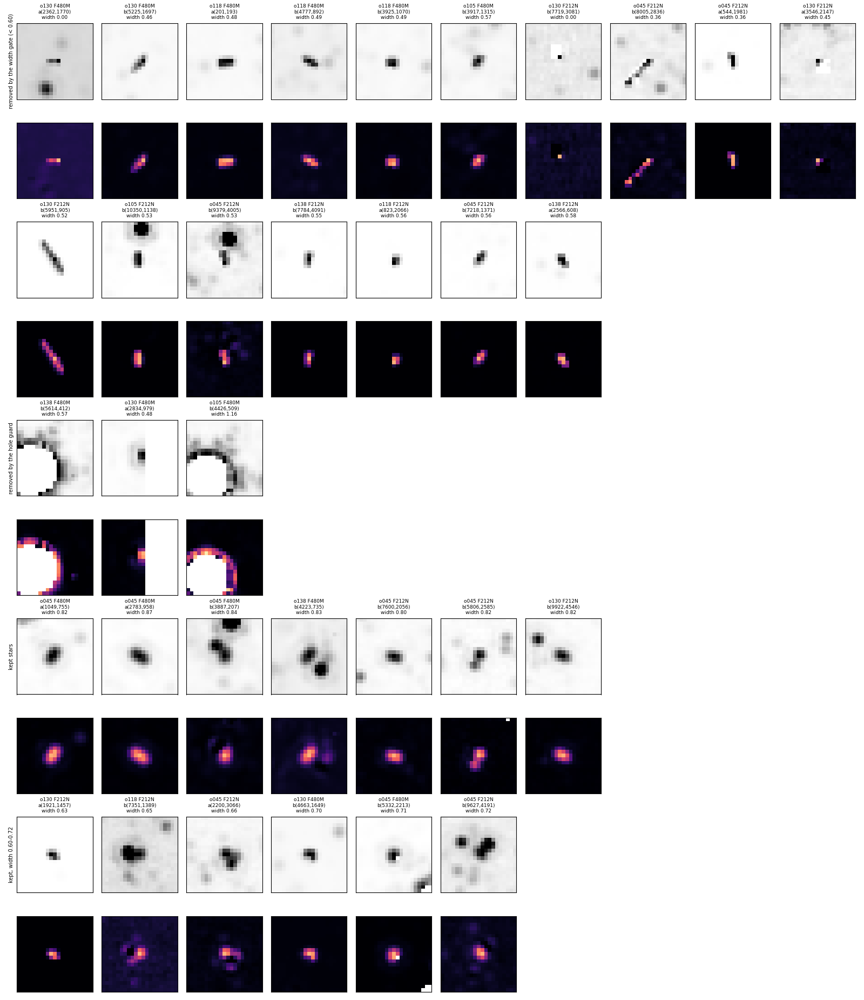

# i2d residual seed: opt-in window for bright detections of any roundness

The i2d-seed daofind keeps `|roundness| ≤ 0.5`, and the opt-in loose window
([../faint_seed_roundness/README.md](../faint_seed_roundness/README.md); 0.8 tested)
adds detections up to that roundness where the annulus prominence is ≥ 5.  Some
bright stars that the m6 fit left mostly in the residual have a roundness beyond
±0.8 (19 of the 80 leftover targets of the probe below).  No window admits such a
star, so it never enters the m7 seed, gets no m7 fit row and stays a bright
leftover in the m7 residual i2d.

This branch adds an **opt-in** window (`--manual-seed-round-bright-max`, default
0 = off; 1.5 tested).  A detection with roundness in (0.8, 1.5] and sharpness in
0.4–1.2 enters the m7 seed when it passes five tests on the detection image (the
m6 residual i2d minus its smoothed background):

| test | flag | default | definition |
|---|---|---|---|
| annulus prominence | `--manual-seed-round-bright-prom-min` | 50 | (core peak, r < 1.5 px − median of the 4–10 px annulus) / annulus MAD |
| unsubtracted fraction | `--manual-seed-round-bright-frac-min` | 0.9 | 3×3 peak of the detection image / 3×3 peak of the data co-add, both after the same background subtraction |
| hole guard | none | 20 px, 4 px | the detection is dropped when an 8-connected masked blob (SCI not finite or WHT ≤ 0) of at least 20 pixels lies within 4 px |
| width | `--manual-seed-round-bright-width-min` | 0.60 | short-axis width over the PSF standard deviation (FWHM / 2.355); 0 = off |
| ERR S/N | `--manual-seed-round-bright-snr-min` | 100 | peak / i2d ERR at the detection |

Admitted detections carry `seed_round_bright` = True.  The column exists only when
the window is on, and with the window off the seed catalog is unchanged.  A run
without an ERR plane, or without the data co-add on the same grid, gets no bright
seeds.  The ERR S/N floor acts as a flux floor and ERR differs between the bands:
100 is tuned on F480M, and F212N needs `--manual-seed-round-bright-snr-min 30`
([S/N floor per band](#sn-floor-per-band)).

## What the evidence covers

Seed counts, position matches against the leftovers of the control m7 residual,
one-frame replays of the m7 fit, and tile-level A/Bs on o105 F212N ([below](#tile-level-ab-on-o105-f212n)),
o045 F212N ([below](#tile-level-ab-on-o045-f212n)) and the tile-bands o118 F212N, o130 F212N, o138 F212N and o045 F480M ([below](#tile-level-ab-on-o118-o130-o138-f212n-and-o045-f480m))
that render the window rows together with the exemption rows of #1377 into the
m7 residual i2d.  No vetting or finalize ran with the window on, and F480M on
o105, o118, o130 and o138 was not run at tile level.

`scripts/realfunc.py` runs the committed `_build_i2d_augmented_seed` on the
production m6 residual i2d of each Brick tile (o045, o105, o118, o130, o138), band
(F212N, F480M) and module (nrca, nrcb), with the production m7 i2dseed catalog as
the previous seed.  Pass A has the window off and pass B has it on.  Every count
below is a log line of that function.  The control leftovers come from the m7
residual of the residual-cleanup work with the DQ_SAT dilation and the edge band on;
those runs are not part of this branch.

## Stars the window can reach

A read-only probe (a one-off script that is not part of this branch) ran daofind
on the detection image of each module with the production bounds (|roundness| ≤
0.5, sharpness 0.4–1.2), with the loose roundness bound (±0.8) and with no bound.
The detection threshold is the minimum of the local-noise map, so every local
maximum is a candidate and the bounds alone decide.  The targets are the
NOT_IN_M7_CATALOG leftovers of the control m7 run with a residual peak ≥ 200
MJy/sr: 53 at F480M and 27 at F212N over the five tiles.  Some of them are
single-exposure events or extended objects and not stars.  Each target gets the
best status of the modules that cover it, from the nearest detection within 2.5 px:

| status | meaning | F480M | F212N |
|---|---|---|---|
| TIGHT_OK | a detection passes the production bounds | 20 | 1 |
| LOOSE_ONLY | a detection passes the loose roundness bound and fails the production one | 2 | 0 |
| ROUND | the nearest unbounded detection has \|roundness\| > 0.8 and sharpness in 0.4–1.2 | 9 | 10 |
| SHARP | the nearest unbounded detection has \|roundness\| ≤ 0.8 and sharpness outside 0.4–1.2 | 17 | 4 |
| NO_DET | no detection within 2.5 px | 5 | 12 |
| all targets | | 53 | 27 |

The 19 ROUND targets (9 at F480M, 10 at F212N) are the ones this window can add:
it relaxes the roundness bound and keeps the sharpness bound.  A TIGHT_OK target
already has a detection inside the production window, and the window of this
branch does not address it.  The SHARP and NO_DET targets (22 at F480M, 16 at
F212N) are out of reach of any roundness window.

## Stage counts

Base run, ten modules per band.  The first column counts the detections with
roundness in (0.8, 1.5] and sharpness in 0.4–1.2 over the detection image; each
further column counts the detections left after that test.  The column ERR S/N ≥ 5
is a fixed floor of the function that no candidate of these runs fails; the next
column is the ERR S/N floor of the run (F480M the default of 100, F212N 30).  The
last column counts rows of the output seed catalog that the production seed lacks:
a detection within 0.5 × FWHM of a production row merges with it in the seed step.

**F480M**

| tile | module | roundness in (0.8, 1.5] | prominence >= 50 | fraction >= 0.9 and hole guard | width >= 0.60 | ERR S/N >= 5 | ERR S/N >= 100 | rows new to the production seed |
|---|---|---|---|---|---|---|---|---|
| o045 | nrca | 11603 | 62 | 2 | 2 | 2 | 2 | 2 |
| o045 | nrcb | 11799 | 66 | 2 | 2 | 2 | 2 | 2 |
| o105 | nrca | 11162 | 61 | 4 | 4 | 4 | 4 | 4 |
| o105 | nrcb | 11593 | 87 | 3 | 2 | 2 | 2 | 2 |
| o118 | nrca | 10721 | 46 | 4 | 3 | 3 | 3 | 3 |
| o118 | nrcb | 11249 | 58 | 9 | 7 | 7 | 7 | 7 |
| o130 | nrca | 10449 | 33 | 4 | 3 | 3 | 2 | 2 |
| o130 | nrcb | 10818 | 40 | 5 | 4 | 4 | 2 | 1 |
| o138 | nrca | 10912 | 32 | 0 | 0 | 0 | 0 | 0 |
| o138 | nrcb | 11363 | 36 | 4 | 4 | 4 | 3 | 2 |
| all | | 111669 | 521 | 37 | 31 | 31 | 27 | 25 |

**F212N**

| tile | module | roundness in (0.8, 1.5] | prominence >= 50 | fraction >= 0.9 and hole guard | width >= 0.60 | ERR S/N >= 5 | ERR S/N >= 30 | rows new to the production seed |
|---|---|---|---|---|---|---|---|---|
| o045 | nrca | 58212 | 148 | 18 | 17 | 17 | 16 | 16 |
| o045 | nrcb | 58393 | 160 | 32 | 29 | 29 | 28 | 28 |
| o105 | nrca | 60179 | 144 | 17 | 17 | 17 | 15 | 15 |
| o105 | nrcb | 59346 | 196 | 25 | 24 | 24 | 24 | 24 |
| o118 | nrca | 70491 | 106 | 10 | 9 | 9 | 8 | 8 |
| o118 | nrcb | 69376 | 83 | 4 | 4 | 4 | 3 | 3 |
| o130 | nrca | 71716 | 93 | 6 | 5 | 5 | 5 | 5 |
| o130 | nrcb | 71547 | 90 | 6 | 4 | 4 | 4 | 4 |
| o138 | nrca | 63979 | 103 | 22 | 21 | 21 | 14 | 14 |
| o138 | nrcb | 63891 | 133 | 20 | 19 | 19 | 15 | 15 |
| all | | 647130 | 1256 | 160 | 149 | 149 | 132 | 132 |

With the window off (pass A) the output seed has the same row count as the
production seed in all twenty modules: 0 new rows.

## What each test removes

Rows new to the production seed with one test relaxed (`--frac 0` and `--width 0`
of `scripts/realfunc.py`; the hole guard stays on):

| band, ERR S/N floor | all tests | `--width 0` | `--frac 0` | `--frac 0 --width 0` |
|---|---|---|---|---|
| F480M, 100 | 25 | 29 | 169 | 366 |
| F212N, 30 | 132 | 139 | 434 | 732 |

The fraction test removes 337 of the 366 candidates (92%) that pass the other
tests at F480M and 593 of 732 (81%) at F212N.  The width test removes 4 of 29
(14%) and 7 of 139 (5%) when the fraction test is on, and 197 of 366 (54%) and 298
of 732 (41%) when it is off.  With the fraction test off, 169 (F480M) and 434
(F212N) candidates remain, so the width test does not replace the fraction test.
With the fraction test off, the hole guard alone takes the 521 (F480M) and 1,256
(F212N) detections that pass the prominence test down to 463 and 1,248.

## Hole guard

The rim of a saturated core is unsubtracted too, and it passes the prominence and
fraction tests.  `scripts/holeguard.py` lists the masked blob near a position:

| position | masked blob within 4 px | hole guard |
|---|---|---|
| o138 F480M nrcb (5614, 412) | 156 px, nearest pixel 1.0 px away | drops |
| o130 F480M nrca (2834, 979) | the masked region outside the footprint (6,590,879 px), 2.0 px away | drops |
| o105 F480M nrcb (4426, 509) | 112 px, 1.4 px away | drops |
| o045 F480M nrcb (5332, 2213) | 1 px, 1.4 px away | keeps |
| o045 F480M nrcb (3887, 207), o105 F480M nrcb (4812, 1939), o118 F480M nrcb (5585, 741) | none | keeps |

The three dropped candidates are in the second block of the figure below.  Their
widths (next section) are 0.57, 0.48 and 1.16 PSF standard deviations, so the width
test alone would remove the first two and not the rim at o105 (4426, 509).  The
20-pixel threshold lets the single masked pixel beside o045 (5332, 2213) through.

## Width gate

Thin streaks and single-pixel spikes pass the other tests.  The width is the square
root of the smaller eigenvalue of the covariance of the pixel positions (weighted
by the pixel values) of the 8-connected pixels at 25% of the 3×3 peak or above, in a
15×15 window; it is 0 when that set has two pixels or fewer.  In units of the PSF
standard deviation (FWHM / 2.355, with FWHM from `reduction/fwhm_table.ecsv`:
2.341 px for F212N and 2.574 px for F480M, so σ = 0.994 px and 1.093 px) the default
0.60 is 0.596 px at F212N and 0.656 px at F480M.

**Simulation** (`scripts/widthsim.py`; Gaussian stars of FWHM 2.34 px for F212N and
2.57 px for F480M at 400 random sub-pixel positions each; width over the PSF
standard deviation):

| star | peak S/N | minimum | 5th percentile | median | maximum |
|---|---|---|---|---|---|
| F212N | noiseless | 0.71 | 0.71 | 0.74 | 0.87 |
| F212N | 100 | 0.71 | 0.71 | 0.74 | 0.87 |
| F212N | 30 | 0.69 | 0.71 | 0.76 | 0.88 |
| F480M | noiseless | 0.69 | 0.71 | 0.74 | 0.82 |
| F480M | 100 | 0.66 | 0.71 | 0.73 | 0.82 |
| F480M | 30 | 0.65 | 0.70 | 0.74 | 0.85 |

Noiseless Gaussians narrower than the PSF measure 0.00–0.58 px (FWHM 1.0 px, median
0.00), 0.00–0.58 px (1.4 px, median 0.46) and 0.53–0.67 px (1.8 px, median 0.57).  A
single pixel and a one-pixel streak, horizontal or diagonal, measure 0.0 px.  Equal
pairs of F212N stars 2, 3 and 4 px apart measure 0.77, 0.74 and 0.77 of the PSF
standard deviation, so a blend of two stars passes.

**Candidates** (`scripts/realfunc.py` writes the widths of every detection that
reaches the width test, that is, passes prominence, fraction and the hole guard; the
five Brick tiles, any ERR S/N):

| band | candidates | below 0.60 | range below | at or above 0.60 | range above (median) |
|---|---|---|---|---|---|
| F480M | 37 | 6 | 0.000–0.571 | 31 | 0.701–1.249 (0.830) |
| F212N | 160 | 11 | 0.000–0.582 | 149 | 0.627–1.874 (0.835) |

All 197 widths are finite.  The values next to the cut are 0.494, 0.571 | 0.701,
0.708 (F480M) and 0.564, 0.582 | 0.627, 0.652 (F212N), so the default sits in a gap
of the measured values in both bands.  The counts below 0.55, 0.60, 0.65 and 0.70
are 5, 6, 6 and 6 (F480M) and 8, 11, 12 and 14 (F212N); 0.55 instead of 0.60
changes one seed per band (F212N 133 → 132, F480M 26 → 25).

Each cell has the module data i2d minus the m6 smoothed background on top (gray,
−5 MJy/sr to the 3×3 peak) and the detection image below it (magma, −5 MJy/sr to
1.2 × its 3×3 peak), 21 px across; the title has the tile, band, module, position
(module pixels) and the width in PSF standard deviations (`scripts/widthfig.py`).
The blocks are the 17 candidates the width test removes, the 3 the hole guard
removes, 7 kept stars and the kept candidates with the lowest widths above the cut
(the two lowest of F480M and the four lowest of F212N).

By eye, most of the 17 removed candidates are single pixels, or lines and bars one
or two pixels wide and three or more pixels long, several of them beside a bright
star or a masked hole.  A few are compact blobs about two pixels across: F480M
(3925, 1070) and (3917, 1315), F212N (823, 2066), (7218, 1371) and (2566, 608).
The lowest-width kept candidates (F480M (4663, 1649) and (5332, 2213); F212N
(1921, 1457)) look the same as those blobs.  The kept stars have widths of
0.80–0.87 and PSF-like cores, several with a close neighbour.  The width test
removes the lines, bars and single pixels, and it removes the compact blobs below
0.60 by the position of the cut alone: by this measure a compact source that looks
like a faint star cannot be told from one.

## Where the seeds land

A seed sits on a leftover when a leftover of the control m7 residual lies within
1.5 mosaic pixels of it (a leftover is a star whose residual peak is ≥ 50 MJy/sr
and more than 0.7 of its data peak).  Each seed is matched to the nearest row of
the candidate table of the control run within 1.5 mosaic pixels; a seed with no
leftover sits where the control m7 residual has none, either because its m6 peak is
below 50 MJy/sr or because the control run subtracts it.

**F480M** (25 seeds):

| tile | seeds | matched to a candidate row | on a leftover >= 50 | on a leftover >= 200 | on a probe target (NOT_IN_M7_CATALOG, ≥ 200) | m6 peak < 50 (no leftover) | no leftover and m6 >= 50 |
|---|---|---|---|---|---|---|---|
| o045 | 4 | 4 | 3 | 3 | 3 | 0 | 1 |
| o105 | 6 | 6 | 6 | 4 | 3 | 0 | 0 |
| o118 | 10 | 10 | 10 | 3 | 2 | 0 | 0 |
| o130 | 3 | 3 | 2 | 0 | 0 | 0 | 1 |
| o138 | 2 | 2 | 1 | 0 | 0 | 1 | 0 |
| all | 25 | 25 | 22 | 10 | 8 | 1 | 2 |

Classes of the leftovers that carry a seed: NOT_IN_M7_CATALOG 20 (8 with a residual
peak ≥ 200 MJy/sr), SATSTAR_NEAR 2 (both ≥ 200), none 3.  Every seed:

| tile | module | x, y (module px) | m6 residual peak (MJy/sr) | roundness | ERR S/N | prominence | fraction | nearest satstar row (") | control leftover (MJy/sr) | class of the leftover |
|---|---|---|---|---|---|---|---|---|---|---|
| o045 | nrca | 1049, 755 | 605 | 1.17 | 604 | 87 | 0.98 | 1.01 | 616 | NOT_IN_M7_CATALOG |
| o045 | nrca | 2783, 958 | 436 | 1.35 | 317 | 124 | 1.00 | 5.68 | 444 | NOT_IN_M7_CATALOG |
| o045 | nrcb | 3887, 207 | 198 | 0.81 | 285 | 58 | 0.94 | 3.03 | 201 | NOT_IN_M7_CATALOG |
| o045 | nrcb | 5332, 2213 | 1807 | 0.83 | 262 | 155 | 0.99 | 0.97 | — | — |
| o105 | nrca | 2353, 647 | 125 | 0.91 | 233 | 59 | 1.00 | 6.66 | 127 | NOT_IN_M7_CATALOG |
| o105 | nrca | 866, 788 | 267 | 1.08 | 388 | 71 | 0.95 | 3.02 | 271 | NOT_IN_M7_CATALOG |
| o105 | nrca | 2524, 987 | 368 | 0.85 | 284 | 90 | 1.00 | 5.25 | 373 | NOT_IN_M7_CATALOG |
| o105 | nrca | 40, 1159 | 85 | 1.02 | 133 | 62 | 0.97 | 6.25 | 87 | NOT_IN_M7_CATALOG |
| o105 | nrcb | 5015, 1437 | 360 | 1.35 | 466 | 96 | 1.00 | 3.17 | 367 | NOT_IN_M7_CATALOG |
| o105 | nrcb | 4812, 1939 | 350 | 1.09 | 554 | 123 | 0.99 | 1.02 | 355 | SATSTAR_NEAR |
| o118 | nrca | 2410, 844 | 61 | 0.87 | 163 | 68 | 1.00 | 6.85 | 63 | NOT_IN_M7_CATALOG |
| o118 | nrca | 199, 1288 | 67 | 1.12 | 119 | 57 | 1.00 | 1.21 | 68 | NOT_IN_M7_CATALOG |
| o118 | nrca | 2105, 1989 | 176 | 1.29 | 276 | 113 | 1.00 | 3.10 | 180 | NOT_IN_M7_CATALOG |
| o118 | nrcb | 5585, 741 | 578 | 1.00 | 356 | 137 | 1.00 | 0.69 | 586 | SATSTAR_NEAR |
| o118 | nrcb | 5275, 782 | 61 | 1.16 | 132 | 66 | 1.00 | 4.01 | 61 | NOT_IN_M7_CATALOG |
| o118 | nrcb | 5545, 936 | 117 | 1.00 | 177 | 64 | 0.96 | 1.65 | 119 | NOT_IN_M7_CATALOG |
| o118 | nrcb | 4448, 1449 | 237 | 1.06 | 459 | 124 | 0.96 | 3.30 | 239 | NOT_IN_M7_CATALOG |
| o118 | nrcb | 4809, 1549 | 382 | 1.20 | 593 | 125 | 1.00 | 5.90 | 386 | NOT_IN_M7_CATALOG |
| o118 | nrcb | 4272, 1976 | 51 | 1.17 | 206 | 56 | 0.99 | 4.69 | 52 | NOT_IN_M7_CATALOG |
| o118 | nrcb | 3582, 2179 | 64 | 0.86 | 160 | 71 | 0.95 | 1.92 | 65 | NOT_IN_M7_CATALOG |
| o130 | nrca | 1201, 305 | 297 | 0.99 | 254 | 453 | 1.00 | 6.22 | — | — |
| o130 | nrca | 791, 885 | 50 | 1.07 | 160 | 67 | 0.99 | 9.63 | 51 | NOT_IN_M7_CATALOG |
| o130 | nrcb | 4220, 1427 | 109 | 1.23 | 315 | 78 | 0.94 | 1.98 | 113 | NOT_IN_M7_CATALOG |
| o138 | nrcb | 4223, 735 | 73 | 1.16 | 242 | 52 | 0.95 | 3.36 | 76 | NOT_IN_M7_CATALOG |
| o138 | nrcb | 3256, 956 | 33 | 0.90 | 137 | 51 | 1.00 | 3.29 | — | — |

The three seeds without a leftover are o045 nrcb (5332, 2213), the compact source
in the figure with one masked pixel beside it (m6 residual peak 1,807 MJy/sr, 0.97"
from a saturated-star row); o130 nrca (1201, 305), with a prominence of 453, nearly
three times the next highest of the 25 seeds (155), which I did not inspect; and o138
nrcb (3256, 956) with an m6 residual peak of 33 MJy/sr, below the 50 MJy/sr of a
leftover.

**F212N** (132 seeds):

| tile | seeds | matched to a candidate row | on a leftover >= 50 | on a leftover >= 200 | on a probe target (NOT_IN_M7_CATALOG, ≥ 200) | m6 peak < 50 (no leftover) | no leftover and m6 >= 50 |
|---|---|---|---|---|---|---|---|
| o045 | 44 | 44 | 44 | 4 | 0 | 0 | 0 |
| o105 | 39 | 39 | 38 | 5 | 2 | 0 | 1 |
| o118 | 11 | 11 | 10 | 1 | 1 | 1 | 0 |
| o130 | 9 | 9 | 7 | 3 | 0 | 0 | 2 |
| o138 | 29 | 29 | 29 | 1 | 1 | 0 | 0 |
| all | 132 | 132 | 128 | 14 | 4 | 1 | 3 |

Classes: NOT_IN_M7_CATALOG 80 (4 with a residual peak ≥ 200 MJy/sr), SATSTAR_NEAR 46
(10 of them ≥ 200), VETTED_OUT 2, none 4 (one with a residual peak below 50 MJy/sr,
three above it).  Most F212N seeds sit on leftovers of 50–200 MJy/sr: 14 of the 132
seeds sit on a leftover ≥ 200 MJy/sr, against 10 of 25 at F480M.

## Replays of the m7 fit

One-frame replays of the production m7 command of a frame, with the seed of the
window-on run (treatment) or the production seed (control).  A target is a seed
position mapped into the frame; the table counts targets with a fitted row within
1 px.

| band | frames | targets | row within 1 px, treatment | row within 1 px, control | rows only in the treatment |
|---|---|---|---|---|---|
| F480M o045 | 3 | 4 | 4 | 0 | 4 |
| F212N o045 | 7 | 40 | 38 | 1 | 37 |

Frames: F480M jw10678045001_02101_00001_nrcblong, jw10678045001_02101_00002_nrcalong
and jw10678045001_02101_00004_nrcblong; F212N jw10678045001_02101_NNNNN_DET with
NNNNN_DET = 00002_nrcb4, 00004_nrca3, 00004_nrcb3, 00005_nrca2, 00005_nrcb3,
00006_nrcb1 and 00006_nrcb4.

The seeds of the F480M replay equal the final seeds of o045 (2 rows per module).
The F212N replay used the seed of an earlier run of the same function with the
width test at 0.55; it differs from the final one by a single row, o045 nrcb
(7218, 1371) with a width of 0.56, which the default 0.60 removes.  The two F212N
targets without a row within 1 px are in the frames 00002_nrcb4 and 00006_nrcb4; the
nearest fitted rows are 5.3 px away.  The single control hit is a production row
0.23 px from the target (the treatment row is 0.04 px away).  The fitted
rows lie within 0.35 px (F480M) and 0.47 px (F212N) of their targets, with qfit
0.02–0.29 (median 0.16) and 0.09–0.44 (median 0.31).  The replays show that the new
seeds survive the per-frame fit as rows; they do not measure the residual i2d (the
tile-level A/Bs below do, for F212N on all five tiles and F480M on o045).

## Tile-level A/B on o105 F212N

The 39 rows of the relaxed bright window of this PR and the 42 rows of the
far-companion exemption (#1377) were fitted together in all 48 frames of o105
F212N (8 detectors, 6 exposures), merged and rendered into the m7 residual i2d.
The aim was to see whether the rows survive the frame fit and the merge, and
what they do to the whole-star leftovers and the big craters of that image.
The scripts of this section (the replay of the m7 fit, the combination of the
frame catalogs, the render and the scoring) are not part of this repo;
`results/tile_ab_o105_F212N_*.txt` hold their outputs.

**Arms.**  Each arm replays the production m7 fit command of every frame with
the production options and combines the 48 frame catalogs into one merged
catalog.  The replays used two states of the saturated-star PSF grid (see
[below](#two-psf-grid-states-among-the-replays)); the arms with the same state
are the ones to compare.

| arm | m7 seed | saturated-star PSF grid | `DAOPHOT_DEDUP_NONPOSITIVE` (#1366) | merge-pair rescue (#1365; ratio 3, floor 500) |
|---|---|---|---|---|
| `dnc` | production | rebuilt | off | off |
| `dnp3` | production | rebuilt | on | off |
| `dnp3p` | production | rebuilt | on | on |
| `dncg` | production | cached | on | off |
| `dncgp` | production | cached | on | on |
| `sd1` | production + 81 rows | cached | on | off |
| `sd1p` | production + 81 rows | cached | on | on |

The 81 added rows are the 39 rows of the relaxed window of this PR (ERR S/N 30;
a relaxed row within 30 mas of an exemption row is dropped) and 42 exemption
rows (#1377; own-band S/N 50).  Per module the added rows are nrca 15 + 15 and
nrcb 27 + 24 (exemption + relaxed).  `sd1` against `dncg` is the effect of the
81 added rows alone, and `sd1p` against `dncgp` the same with the rescue on in
both arms.  `dnp3` against `dnc` is the effect of #1366 alone, `dncgp` against
`dncg` the effect of the rescue alone, and `dnp3` against `dncg` the effect of
the PSF grid state alone.  Two further arms, `sdloc` and `sdlocp`, were built
before `dncg` existed: they take the `dnp3` and `dnp3p` rows farther than 0.3″
(about 4 FWHM of F212N, 0.072″) from every added row and the `sd1` and `sd1p`
rows inside those discs.  They give the leftover counts of `sd1` and `sd1p` and
the crater lists of `dnp3`; their numbers are in the results files.

An arm enters the render as the difference between its merged catalog and that
of `dnc`: rows of the production vetted catalog within 0.03″ of a row that
disappeared are removed, and new rows with flux ≥ 0 are added.  No added row is
vetted again, so a row that the vetting would drop stays in the catalog, and
the counts below are the best case for the added rows.  Every arm is rendered
with the production options plus three render flags of #1360 (a draft PR that
this branch does not contain): `SINGLE_EXPOSURE_EVENT_MASK=1` sets DO_NOT_USE
on the pixels of a compact saturated core that one frame carries and the other
covering frames do not, `NEGATIVE_PIXEL_MASK_NSIGMA=50` sets DO_NOT_USE on
pixels with SCI below −50 × ERR, and `MERGE_ROW_RESID_SUPPORT_MIN=0.3`
re-renders a row at a lower flux when the PSF fit to the merged-catalog
residual of its frame has an amplitude below −0.7 × the flux of the row.  The
residual image is scored with the same mask settings in every arm: the
footprint mask (a disk of 1 × the radius of the saturated area plus 2 px around
each row of the production consolidated saturated-star catalog, and a disk of
at least 25 px radius around the rows with `flux_fit` ≥ 10⁶; #1361, #1364), the
DQ_SAT dilation of 4 px (#1372) and, in the second table, the edge band of 8 px
(#1373).  The masks were applied to the rendered residual images by emulation
scripts; the PRs that add them state where the emulation was compared with
their code.  None of these PRs is merged.  The counts of this section are those
of the flagged render and are not comparable to the counts of the production
render of o105 F212N.

**Counts.**  Whole-star leftovers (residual peak ≥ N MJy/sr, at least 50, and
more than 0.7 of the data peak at the star) and big craters (depth > 50 MJy/sr
and depth more than 0.3 of the model peak, counted at depth ≥ 50, 200 and 500
MJy/sr) of the m7 residual i2d of o105 F212N.

DQ_SAT dilation of 4 px:

| arm | leftovers ≥ 50 | ≥ 100 | ≥ 200 | ≥ 500 | ≥ 1000 | big craters ≥ 50 | ≥ 200 | ≥ 500 |
|---|---|---|---|---|---|---|---|---|
| `dnc` | 752 | 201 | 48 | 6 | 3 | 35 | 9 | 1 |
| `dnp3` | 741 | 194 | 45 | 5 | 2 | 35 | 9 | 1 |
| `dnp3p` | 729 | 185 | 41 | 5 | 2 | 35 | 9 | 1 |
| `dncg` | 742 | 194 | 45 | 5 | 2 | 35 | 9 | 1 |
| `dncgp` | 730 | 185 | 41 | 5 | 2 | 35 | 9 | 1 |
| `sd1` | 681 | 149 | 34 | 5 | 2 | 35 | 9 | 1 |
| `sd1p` | 669 | 140 | 30 | 5 | 2 | 35 | 9 | 1 |

DQ_SAT dilation of 4 px and edge band of 8 px:

| arm | leftovers ≥ 50 | ≥ 100 | ≥ 200 | ≥ 500 | ≥ 1000 | big craters ≥ 50 | ≥ 200 | ≥ 500 |
|---|---|---|---|---|---|---|---|---|
| `dnc` | 735 | 186 | 38 | 1 | 1 | 35 | 9 | 1 |
| `dnp3` | 724 | 179 | 35 | 0 | 0 | 35 | 9 | 1 |
| `dnp3p` | 712 | 170 | 31 | 0 | 0 | 35 | 9 | 1 |
| `dncg` | 725 | 179 | 35 | 0 | 0 | 35 | 9 | 1 |
| `dncgp` | 713 | 170 | 31 | 0 | 0 | 35 | 9 | 1 |
| `sd1` | 664 | 134 | 24 | 0 | 0 | 35 | 9 | 1 |
| `sd1p` | 652 | 125 | 20 | 0 | 0 | 35 | 9 | 1 |

**Leftovers.**  Against `dncg`, `sd1` clears 45 of the 194 whole-star leftovers
≥ 100 MJy/sr (a leftover is cleared when the treatment has none within 3 px of
its position).  No leftover ≥ 100 MJy/sr gets worse by more than a factor of
1.5, and none appears that `dncg` does not have.  The count at ≥ 200 MJy/sr
falls from 45 to 34 (35 to 24 with the edge band), and the ≥ 500 count stays at
5 (0 with the edge band).  By leftover class, the 45 leftovers ≥ 200 MJy/sr of
`dncg` are 29 SATSTAR_NEAR, 11 NOT_IN_M7_CATALOG, 4 VETTED_BUT_UNSUBTRACTED and
1 VETTED_OUT; the 34 of `sd1` are 21, 8, 4 and 1.  With the rescue on in both
arms, `sd1p` against `dncgp` clears 45 as well and adds none (≥ 200 MJy/sr: 41
to 30, and 31 to 20 with the edge band).  The rescue alone clears 9 leftovers
(`dncgp` against `dncg`), and the same 9 positions (within 3 px) with the added
rows (`sd1p` against `sd1`); these 9 have no added row nearby.  Leftovers of
212 to 358 MJy/sr at (434, 3684), (3245, 3878), (7030, 3275) and (9794, 833)
remain in every arm (the counts file lists the residual peak at 13 stars of
this tile for each arm).

**Where the clears occur.**  Of the 194 leftovers of `dncg`, 48 have an added
row within 0.1″, and `sd1` clears 45 of them.  It clears none of the other 146.
The attribution is by position (`results/tile_ab_o105_F212N_attribution.txt`).
The nearest added row of each of the 45 cleared leftovers lies within 0.035″
(median 0.011″): a relaxed row of this PR for 25 leftovers and an exemption row
of #1377 for 20.  45 of the 81 added rows lie under a cleared leftover.  The
three leftovers with an added row nearby that persist have peaks of 181, 178
and 150 MJy/sr, and the rows under them are relaxed rows (0.008″, 0.025″ and
0.025″ away).  No arm contains one kind of row alone, so the effect of the
exemption alone and of the relaxed window alone is not measured.

**Craters.**  The big craters of `sd1` are those of `dncg`: 35 in the
DQ_SAT-dilated render (9 ≥ 200 MJy/sr, 1 ≥ 500), with no crater new or gone
(positions matched within 3 px), depth changes below 0.1 MJy/sr, and 245
craters deeper than 50 MJy/sr at any depth/model ratio in both.  The same holds
with the edge band (35 in both; 244 deeper than 50 MJy/sr), with the footprint
mask and its ring zone only (46 in both; 271) and in the render without any
mask (134 in both, none new or gone; 6107 craters deeper than 50 MJy/sr in
`dncg` and 6108 in `sd1`).  With the rescue on in both arms, `sd1p` against
`dncgp` gives the same lists at the same four render levels (35, 35, 46 and 135
big craters in both, none new or gone).  The rescue adds one big crater to the
unmasked render, (4658, 4352) of depth 201 MJy/sr, to `dncgp` and `sd1p` alike.
The 81 added rows therefore add no big crater to this tile and remove none at
any of these four render levels (`results/tile_ab_o105_F212N_craters.txt`).
#1366 alone (`dnp3` against `dnc`) leaves the masked crater lists unchanged and
adds five big craters of depth 82 to 161 MJy/sr to the unmasked render (132 to
137).

**Survival of the added rows.**  Of the 42 exemption rows, 38 appear as new
rows of the merged catalog (no row of `dnp3` within 0.1″) and 4 coincide with a
row that `dnp3` already had.  Of the 39 relaxed rows, 33 are new, 5 coincide
with a `dnp3` row and 1 has no merged row within 0.1″ (a seed of flux 3.2 × 10⁵
whose nearest merged row lies 0.22″ away).  The median `flux_fit_avg` of the
new rows (in the unit of the catalog column) is 1411 for the exemption rows
against a median seed flux of 1392, and 1693 for the relaxed rows against 1341
(`results/tile_ab_o105_F212N_survival.txt`).  The frame catalogs of `dnp3` and
`dncg` differ by 4 lost rows and no added row within 0.5″ of an added row; the
reference for these counts is `dnp3`.

### Two PSF grid states among the replays

The replays of the arms `dnc`, `dnp3` and `dnp3p` and those of `sd1` and `sd1p`
used two versions of the replay script, which stage the saturated-star PSF grid
differently.  The first rebuilt it from MAST (the OPD file closest in time to
2026-09-14, O2026091501), and the second loaded the grid that the production
run had cached.  The `EPSFSHFT` keyword of the frame catalogs is 0.34–0.50 mpix
larger with the cached grid in each of the 8 detectors (45.208 against 44.706
mpix in nrca1; `results/tile_ab_o105_F212N_replay_state.txt`).  `dncg` and
`dncgp` repeat `dnp3` and `dnp3p` with the cached grid; their `EPSFSHFT` equals
that of `sd1` in all 8 detectors.

The grid state changes the frame catalogs throughout the tile.  Between `dncg`
and `dnp3`, 3265 frame rows are lost, 3178 are added, and 145,316 of the 2.24
million matched rows change their fitted flux by more than 1%.  Within 3″ of an
added row lie 3.7% of the lost rows, 3.1% of the added rows and 4.0% of the
rows with a changed flux, against 4.1% of all rows; within 0.5″ of an added row
lie 4 lost rows and no added row.  Between `dncg` and `sd1`, which share the
grid state, 11 rows are lost, 279 are added and 126 matched rows change their
flux by more than 1%, and every one of them lies within 0.5″ of one of the 81
added rows (277 of the 279 added rows within 0.15″).  The added rows therefore
change the per-frame fit only locally.  #1366 alone (`dnc` against `dnp3`, same
grid) removes 121 rows, adds 1739 and changes 376 fluxes, with 4.1% of the
removed rows and 4.1% of the added rows within 3″ of an added row.

In the render the grid state changes no leftover count: `dnp3` against `dncg`
clears none and adds none at ≥ 100 MJy/sr (741 and 742 leftovers ≥ 50 MJy/sr).
It changes the crater list by one in the masked renders: (2513, 951; depth 210
MJy/sr, model peak 690) is a big crater of `dnp3` and not of `dncg`, and (6771,
3357; depth 371, model peak 854) is a big crater of `dncg` and `sd1` and not of
`dnp3`.  The unmasked render of `dnp3` has three big craters that `dncg` lacks:
(2513, 951), (2571, 1972) and (9011, 2617), of depth 159 to 210 MJy/sr.
Against the `dnp3` control, `sd1` shows one new and one lost big crater, both
more than 11″ from every added row (11.7″ and 12.0″); against `dncg` it shows
none, so these two come from the grid state.

### What this test does not show

- The added rows are not vetted again.  The leftover and crater counts above
  are the best case for the added rows; a row that the vetting would drop stays
  in the catalog.
- The masks of the counts are emulations applied to the rendered residual
  image.  No frame, merge or vetting stage ran with a mask, and a mask hides a
  leftover or a crater in the image without changing the catalog or its
  photometry.
- One tile and one band in this section (o105 F212N).  o045 F212N (the next
  section) and the tile-bands o118 F212N, o130 F212N, o138 F212N and o045 F480M
  ([Tile-level A/B on o118, o130, o138 F212N and o045
  F480M](#tile-level-ab-on-o118-o130-o138-f212n-and-o045-f480m)) repeat the
  test, and F480M on o105, o118, o130 and o138 was not run.  The S/N values (50
  for the exemption, 30 for the relaxed window) were tuned on F212N.
- No arm contains only one kind of added row, so the share of the exemption and
  of the relaxed window in the cleared leftovers rests on the position of the
  nearest added row.
- A leftover that disappears does not show that its source was a star: a
  PSF-shaped row also subtracts a PSF-shaped excess.  The crater test is the
  check against over-subtraction (no new crater at any mask level); it does not
  separate a faint star from a knot of extended emission.
- An added row does not always clear the leftover under it: 3 of the 48
  leftovers with an added row within 0.1″ persist.
- The added rows leave the 35 big craters of the masked render untouched, so
  they address leftovers only.  With the edge band `sd1p` still has 652, 125,
  20 and 0 leftovers at ≥ 50, 100, 200 and 500 MJy/sr.

## Tile-level A/B on o045 F212N

The 45 rows of the relaxed bright window of this PR and the 53 rows of the
far-companion exemption (#1377) were fitted together in all 48 frames of o045
F212N (8 detectors, 6 exposures), merged and rendered into the m7 residual
i2d.  The test repeats the o105 test above on a second tile of the same band,
with a smaller arm set.  The aim is again to see whether the rows survive the
frame fit and the merge, and what they do to the whole-star leftovers and the
big craters of that image.  The scripts (the replay of the m7 fit, the
combination of the frame catalogs, the render and the scoring, adapted from
those of the o105 test) are not part of this repo;
`results/tile_ab_o045_F212N_*.txt` hold their outputs.

**Arms.**  Each arm replays the production m7 fit command of every frame with
the production options and combines the 48 frame catalogs into one merged
catalog.  All four arms use the saturated-star PSF grid that the production
run cached and `DAOPHOT_DEDUP_NONPOSITIVE` (#1366).

| arm | m7 seed | saturated-star PSF grid | `DAOPHOT_DEDUP_NONPOSITIVE` (#1366) | merge-pair rescue (#1365; ratio 3, floor 500) |
|---|---|---|---|---|
| `dncg` | production | cached | on | off |
| `dncgp` | production | cached | on | on |
| `sd1` | production + 98 rows | cached | on | off |
| `sd1p` | production + 98 rows | cached | on | on |

The 98 added rows are the 53 exemption rows (#1377; own-band S/N 50) and the
45 rows of the relaxed window of this PR (ERR S/N 30; a relaxed row within 30
mas of an exemption row is dropped, which removed none on this tile).  Per
module the added rows are nrca 25 + 16 and nrcb 28 + 29 (exemption + relaxed).
`sd1` against `dncg` is the effect of the 98 added rows alone, `sd1p` against
`dncgp` the same with the rescue on in both arms, and `dncgp` against `dncg`
the effect of the rescue alone.

An arm enters the render as the difference between its merged catalog and that
of `dncg`: rows of the production vetted catalog within 0.03″ of a row that
disappeared are removed, and new rows with flux ≥ 0 are added.  The render of
`dncg` is therefore the production vetted catalog.  #1366 is on in all four
arms, so it cancels in every difference and no render of this section contains
its effect.  No added row is vetted again, so a row that the vetting would
drop stays in the catalog, and the counts below are the best case for the
added rows.  The render flags of #1360, the footprint mask with its ring zone,
the DQ_SAT dilation of 4 px and, in the second table, the edge band of 8 px
are those of the o105 test above, applied to the rendered residual images by
the same emulation scripts.  The counts of this section are those of the
flagged render and are not comparable to the counts of the production render
of o045 F212N.

**Counts.**  Whole-star leftovers (residual peak ≥ N MJy/sr, at least 50, and
more than 0.7 of the data peak at the star) and big craters (depth > 50 MJy/sr
and depth more than 0.3 of the model peak, counted at depth ≥ 50, 200 and 500
MJy/sr) of the m7 residual i2d of o045 F212N.

DQ_SAT dilation of 4 px:

| arm | leftovers ≥ 50 | ≥ 100 | ≥ 200 | ≥ 500 | ≥ 1000 | big craters ≥ 50 | ≥ 200 | ≥ 500 |
|---|---|---|---|---|---|---|---|---|
| `dncg` | 970 | 239 | 65 | 15 | 4 | 17 | 0 | 0 |
| `dncgp` | 952 | 230 | 60 | 14 | 4 | 18 | 0 | 0 |
| `sd1` | 904 | 187 | 56 | 15 | 4 | 18 | 0 | 0 |
| `sd1p` | 886 | 178 | 51 | 14 | 4 | 19 | 0 | 0 |

DQ_SAT dilation of 4 px and edge band of 8 px:

| arm | leftovers ≥ 50 | ≥ 100 | ≥ 200 | ≥ 500 | ≥ 1000 | big craters ≥ 50 | ≥ 200 | ≥ 500 |
|---|---|---|---|---|---|---|---|---|
| `dncg` | 948 | 228 | 60 | 10 | 3 | 17 | 0 | 0 |
| `dncgp` | 931 | 220 | 56 | 10 | 3 | 18 | 0 | 0 |
| `sd1` | 882 | 176 | 51 | 10 | 3 | 18 | 0 | 0 |
| `sd1p` | 865 | 168 | 47 | 10 | 3 | 19 | 0 | 0 |

**Leftovers.**  Against `dncg`, `sd1` clears 51 of the 239 whole-star
leftovers ≥ 100 MJy/sr (a leftover is cleared when the treatment has none
within 3 px of its position).  No leftover ≥ 100 MJy/sr of `dncg` gets worse
by more than a factor of 1.5, and 1 leftover ≥ 100 MJy/sr appears that `dncg`
does not have: (5805, 2582; SATSTAR_NEAR, 269 MJy/sr).  The new leftover at
(5805, 2582) lies 3.2 px from the cleared leftover of `dncg` at (5806, 2585;
414 MJy/sr), so the two are probably one leftover that went down to 0.65 of
its peak and moved just beyond the 3 px matching radius.  Counted that way,
`sd1` clears 50 of the 239 and lowers the peak of 1 more (414 to 269 MJy/sr).
The count at ≥ 200 MJy/sr goes from 65 to 56 (60 to 51 with the edge band),
and the count at ≥ 500 MJy/sr stays at 15 (10 with the edge band).  By
leftover class, the 65 leftovers ≥ 200 MJy/sr of `dncg` are 41 SATSTAR_NEAR,
16 NOT_IN_M7_CATALOG, 6 VETTED_BUT_UNSUBTRACTED and 2 VETTED_OUT; the 56 of
`sd1` are 34, 14, 6 and 2.

With the rescue on in both arms, `sd1p` against `dncgp` clears 51 leftovers ≥
100 MJy/sr and has 1 leftover ≥ 100 MJy/sr that `dncgp` does not have, the
same one as in `sd1` against `dncg`.  The count at ≥ 200 MJy/sr goes from 60
to 51 (56 to 47 with the edge band).  The rescue alone clears 9 (`dncgp`
against `dncg`) and adds no new leftover; with the added rows (`sd1p` against
`sd1`) it clears 9.  All 9 of the positions that the rescue clears with the
added rows lie within 3 px of a position that it clears without them, and all
9 of the positions that it clears without them lie within 3 px of one that it
clears with them.  Of the 239 leftovers ≥ 100 MJy/sr of `dncg`, 56 have an
added row within 0.035″, and the rescue clears none of them; it clears 9 of
the 183 without an added row within 0.035″.  The counts file lists the
residual peak at the 9 traced stars of o045 (the o045 members of the 22 stars
that #1377 traced through the m7 stages; its cover_targets table) for each
arm: 9 have a whole-star leftover in `dncg`, 5 in `sd1`, 9 in `dncgp` and 5 in
`sd1p`.  The 4 stars that lose the leftover, (4979, 3391), (6277, 2642),
(6355, 3168) and (7311, 2154), are the 4 with an exemption row within 0.1″ at
S/N 50 (the stars that the exemption reaches); the other 5 keep a residual
peak of 212 to 1039 MJy/sr in every arm: (1253, 131), (2970, 3509), (5070,
4424), (6092, 3774) and (6471, 2248).

**Where the clears occur.**  Of the 239 leftovers ≥ 100 MJy/sr of `dncg`, 57
have an added row within 0.1″, and `sd1` clears 51 of them.  It clears none of
the other 182.  The attribution is by position
(`results/tile_ab_o045_F212N_attribution.txt`).  The nearest added row of all
51 cleared leftovers lies within 0.031″ (median 0.014″): 27 under an exemption
row and 24 under a relaxed row.  Of the 98 added rows, 51 lie under a cleared
leftover.  The 5 leftovers with an added row within 0.035″ that persist have
peaks of 155, 125, 121, 108 and 107 MJy/sr, and the rows under them are
exemption and relaxed rows (0.015″, 0.008″, 0.017″, 0.004″ and 0.003″ away).
No arm contains one kind of row alone, so the effect of the exemption alone
and of the relaxed window alone is not measured.

**Craters.**  Big craters of the four arms at four render levels (a crater is
new or gone when no crater of the other tag lies within 3 px of its position;
`results/tile_ab_o045_F212N_craters.txt`):

| render | `dncg` | `dncgp` (against `dncg`) | `sd1` (against `dncg`) | `sd1p` (against `dncgp`) |
|---|---|---|---|---|
| DQ_SAT dilation of 4 px | 17 | 18 (new 2, gone 1) | 18 (new 1, gone 0) | 19 (new 1, gone 0) |
| DQ_SAT dilation and edge band of 8 px | 17 | 18 (new 2, gone 1) | 18 (new 1, gone 0) | 19 (new 1, gone 0) |
| ring zone only | 26 | 27 (new 2, gone 1) | 27 (new 1, gone 0) | 28 (new 1, gone 0) |
| no mask | 147 | 148 (new 2, gone 1) | 148 (new 1, gone 0) | 149 (new 1, gone 0) |

In the render without any mask, 7372 craters are deeper than 50 MJy/sr at any
depth/model ratio in `dncg`, 7372 in `dncgp`, 7376 in `sd1` and 7376 in
`sd1p`.  The number of big craters rises by 1 at each render level (from 17 to
18 with the DQ_SAT dilation of 4 px): with the rescue off (`sd1` against
`dncg`) and on (`sd1p` against `dncgp`), the added rows give a new crater at
(2201, 3065) (depth 60 MJy/sr, model peak 198).  That crater is close to both
criteria (depth 60 against more than 50 MJy/sr, depth over model peak 0.300
against more than 0.3); its nearest vetted-catalog row lies 0.040″ away and
its nearest added row, a relaxed row in nrca, 0.049″ away.  The rescue alone
(`dncgp` against `dncg`) changes the crater list in the same way at each of
the four render levels: a new crater at (4674, 4345) (depth 104 MJy/sr, model
peak 335), a new crater at (8993, 535) (depth 87 MJy/sr, model peak 259) and a
gone crater at (7060, 4678) (depth 85 to 86 MJy/sr, model peak 173).

**Survival of the added rows.**  Of the 53 exemption rows, 45 appear as new
rows of the merged catalog (no row of `dncg` within 0.1″) and 8 coincide with
a row that `dncg` already had.  Of the 45 relaxed rows, 38 are new and 7
coincide with a `dncg` row.  The median `flux_fit_avg` of the new rows (in the
unit of the catalog column) is 1536 for the exemption rows against a median
seed flux of 1522, and 1497 for the relaxed rows against 1190
(`results/tile_ab_o045_F212N_survival.txt`).

**PSF grid state and per-frame differences.**  All four arms use the
saturated-star PSF grid that the production run cached, so the `EPSFSHFT`
keyword of the frame catalogs of `dncg` and `sd1` is equal in all 8 detectors
(26.570 to 69.574 mpix; `results/tile_ab_o045_F212N_replay_state.txt`) and the
two replay sets share one grid state.  Between `dncg` and `sd1`, 16 of the
2,543,465 frame rows are lost, 355 are added and 150 matched rows change their
fitted flux by more than 1%.  Every one of them lies within 0.5″ of one of the
98 added rows (12 of the lost rows, 350 of the added rows and 60 of the
changed rows within 0.15″), and 120 of the 2,543,465 control rows lie within
0.15″ of an added row.  The added rows therefore change the per-frame fit only
locally.

**Remaining leftovers.**  With the edge band, `sd1p` still has 865, 168, 47
and 10 leftovers at ≥ 50, 100, 200 and 500 MJy/sr, and `sd1` has 882, 176, 51
and 10.  By class, the 51 leftovers ≥ 200 MJy/sr of `sd1p` (DQ_SAT dilation
without the edge band) are 32 SATSTAR_NEAR, 13 NOT_IN_M7_CATALOG, 4
VETTED_BUT_UNSUBTRACTED and 2 VETTED_OUT.

**Limits.**  The list under "What this test does not show" above applies to
this tile as well (the added rows are not vetted again, no arm contains one
kind of row alone, and a leftover that disappears does not show that its
source was a star).  The o105 section and this section cover o105 and o045 in
F212N; the section [Tile-level A/B on o118, o130, o138 F212N and o045
F480M](#tile-level-ab-on-o118-o130-o138-f212n-and-o045-f480m) below repeats the
test on the other three tiles in F212N and on o045 in F480M.  The S/N values
were tuned on F212N.

## Tile-level A/B on o118, o130, o138 F212N and o045 F480M

The test of the section "Tile-level A/B on o045 F212N" above is repeated on
o118 F212N, o130 F212N, o138 F212N and o045 F480M.  In every tile-band, the
rows of the relaxed bright window of this PR and the exemption rows of #1377
were fitted together in all frames of the tile-band, merged and rendered into
the m7 residual i2d.  The number of frames is 48 for each of o118 F212N, o130
F212N and o138 F212N (8 detectors with 6 exposures each) and 12 for o045 F480M
(2 detectors with 6 exposures each).  The four arms (`dncg`, `dncgp`, `sd1`,
`sd1p`), the union seed, the render flags of #1360, the footprint mask with
its ring zone, the DQ_SAT dilation, the edge band and the definitions of
leftover, big crater and cleared leftover are those of that section.  The
F212N tile-bands use its mask parameters (DQ_SAT dilation of 4 px, ring zone
of at least 25 px radius around the rows with `flux_fit` ≥ 10⁶, edge band of 8
px); the F480M tile-band uses a DQ_SAT dilation of 3 px, a ring zone of at
least 20 px radius and an edge band of 6 px.  A relaxed row within 30 mas of
an exemption row is dropped, which removed none in these tile-bands.  Every
tile-band has its own control `dncg`, a replay of the production seed with the
saturated-star PSF grid that the production run cached and #1366.  The scripts
(adapted from those of the o045 test) are not part of this repo;
`results/tile_ab_o118_F212N_*.txt`, `results/tile_ab_o130_F212N_*.txt`,
`results/tile_ab_o138_F212N_*.txt` and `results/tile_ab_o045_F480M_*.txt` hold
their outputs.

| tile and band | added rows (exemption + relaxed) | leftovers ≥ 100 MJy/sr cleared | worse | new | leftovers ≥ 200 MJy/sr, `dncg` → `sd1` | leftovers ≥ 500 MJy/sr, `dncg` → `sd1` | big craters, `dncg` → `sd1` | persisting, of those with an added row within 0.035″ |
|---|---|---|---|---|---|---|---|---|
| o118 F212N | 16 (5 + 11) | 6 of 39 | 0 | 0 | 13 → 11 | 5 → 5 | 25 → 26 | 0 of 6 |
| o130 F212N | 12 (3 + 9) | 8 of 30 | 0 | 0 | 20 → 17 | 6 → 6 | 8 → 8 | 0 of 8 |
| o138 F212N | 45 (16 + 29) | 25 of 89 | 0 | 0 | 25 → 23 | 14 → 14 | 23 → 24 | 2 of 27 |
| o045 F480M | 67 (63 + 4) | 3 of 56 | 0 | 0 | 17 → 14 | 1 → 0 | 1 → 1 | 0 of 2 |
| o045 F212N (section above) | 98 (53 + 45) | 51 of 239 | 0 | 1 | 65 → 56 | 15 → 15 | 17 → 18 | 5 of 56 |

The counts of the table are those of the DQ_SAT-dilated render without the
edge band.  "Cleared" counts the leftovers ≥ 100 MJy/sr of `dncg` that have no
leftover of `sd1` within 3 px, "worse" those that `sd1` leaves more than 1.5
times higher, and "new" the leftovers ≥ 100 MJy/sr of `sd1` that `dncg` does
not have.  The last column counts, among the leftovers ≥ 100 MJy/sr of `dncg`
that have an added row within 0.035″, those that `sd1` does not clear.

In o118 F212N, o130 F212N and o138 F212N the frame catalogs of `dncg` and
`sd1` differ only near the added rows: every frame row that is lost, added or
changed in flux by more than 1% lies within 0.5″ of an added row (o118 F212N:
2 lost, 63 added and 13 changed of 1,220,347 frame rows; o130 F212N: 0 lost,
42 added and 18 changed of 1,019,613 frame rows; o138 F212N: 2 lost, 160 added
and 59 changed of 1,939,299 frame rows).  In o045 F480M, 91 of the 495 frame
rows that are lost, added or changed in flux by more than 1% lie farther than
0.5″ from every added row (1 of 10 lost, 2 of 273 added, 88 of 212 changed in
flux); of the 212 changed rows, 124 lie within 0.5″, 209 within 1″ and 209
within 3″ of an added row.  The rows beyond 0.5″ were not examined
individually.  The `EPSFSHFT` keyword of the frame catalogs of `dncg` and
`sd1` is equal in every detector of every tile-band, so the two replay sets of
a tile-band share one saturated-star PSF grid state.

**Exemption floor at F480M.**  The exemption of #1377 is off by default
(`--manual-m7-seed-own-band-companion-keep-snr` 0), and its documented value
of 50 belongs to F212N: the S/N is the ratio of two catalog columns and
depends on the band.  At 50 the exemption adds 2406 rows to o045 F480M (at 30:
3769), against the 53 rows that it adds to o045 F212N.  The F480M test
therefore uses the floor of 150, the floor of the scan (table below) whose 63
rows (22 in nrca, 41 in nrcb) come closest to that number.  The relaxed window
of this PR runs at its default ERR S/N of 100 and adds 4 rows (2 in nrca, 2 in
nrcb).  The floor was chosen by the row count.  The leftover counts of the
table are the same (7, 0, 0) at every floor of the scan from 80 to 150, so
they do not separate the floors in that range.  Of the 63 exemption rows, 7
lie within 0.072″ (the radius of the F212N tests, kept at F480M) of a
whole-star leftover ≥ 50 MJy/sr of the production render and 0 within 0.072″
of one ≥ 100 MJy/sr (at 30: 10 of 3769 rows and 1).  The table lists these
numbers for every floor of the scan.

| own-band S/N floor | rows added (nrca + nrcb) | rows within 0.072″ of a whole-star leftover ≥ 50, ≥ 100, ≥ 200 MJy/sr of the production render |
|---|---|---|
| 30 | 3769 (1907 + 1862) | 10, 1, 1 |
| 40 | 3081 (1504 + 1577) | 10, 1, 1 |
| 50 | 2406 (1150 + 1256) | 8, 0, 0 |
| 60 | 1794 (819 + 975) | 8, 0, 0 |
| 80 | 894 (373 + 521) | 7, 0, 0 |
| 90 | 609 (251 + 358) | 7, 0, 0 |
| 100 | 426 (180 + 246) | 7, 0, 0 |
| 110 | 287 (121 + 166) | 7, 0, 0 |
| 120 | 192 (83 + 109) | 7, 0, 0 |
| 130 | 140 (55 + 85) | 7, 0, 0 |
| 140 | 95 (31 + 64) | 7, 0, 0 |
| 150 (used) | 63 (22 + 41) | 7, 0, 0 |
| 175 | 25 (10 + 15) | 6, 0, 0 |
| 200 | 12 (6 + 6) | 5, 0, 0 |
| 250 | 1 (0 + 1) | 0, 0, 0 |

**o118 F212N.**  The 16 added rows (5 exemption + 11 relaxed; nrca 4 + 8, nrcb
1 + 3) clear 6 of the 39 whole-star leftovers ≥ 100 MJy/sr of `dncg`.  No
leftover ≥ 100 MJy/sr of `dncg` gets worse by more than a factor of 1.5, and
none appears that `dncg` does not have.  The count at ≥ 200 MJy/sr goes from
13 to 11 (9 to 8 with the edge band), and the count at ≥ 500 MJy/sr stays at 5
(4 with the edge band).  All 6 cleared leftovers have an added row within
0.025″ (median 0.017″): 2 under an exemption row and 4 under a relaxed row.
None of the 6 leftovers with an added row within 0.035″ persists.  Of the 5
exemption rows, 3 lie within 0.072″ of a whole-star leftover ≥ 50 MJy/sr of
the production render, 2 within 0.072″ of one ≥ 100 MJy/sr and 1 within 0.072″
of one ≥ 200 MJy/sr.  The added rows change the crater list at 6 of the 8
combinations of render level and arm; at each of these combinations they give
a new crater at (3, 390) (depth 100 MJy/sr, model peak 180 MJy/sr).  At the
other 2 combinations (DQ_SAT dilation of 4 px and edge band of 8 px: both
arms) the crater list does not change.  That crater has a depth of 100 MJy/sr
(criterion: more than 50) and a depth over model peak of 0.555 (criterion:
more than 0.3); its nearest vetted-catalog row lies 0.154″ away and its
nearest added row, an exemption row in nrca, 0.020″ away; it lies 1.4 px from
the cleared leftover of `dncg` at (2, 389; peak 262 MJy/sr), so the two are
probably one feature that the added rows change from a leftover to a crater.
With the rescue on in both arms, `sd1p` against `dncgp` clears 6 leftovers ≥
100 MJy/sr and the count at ≥ 200 MJy/sr goes from 12 to 10.  The rescue alone
(`dncgp` against `dncg`) clears 2, adds no new leftover, and the number of big
craters stays at 25; it clears 0 of the 6 leftovers with an added row within
0.035″ and 2 of the 33 without one.  Of the 5 exemption rows, 4 appear as new
rows of the merged catalog (no row of `dncg` within 0.1″) and 1 coincides with
a row that `dncg` already had; of the 11 relaxed rows, 11 are new and 0
coincide with a `dncg` row.

**o130 F212N.**  The 12 added rows (3 exemption + 9 relaxed; nrca 1 + 5, nrcb
2 + 4) clear 8 of the 30 whole-star leftovers ≥ 100 MJy/sr of `dncg`.  No
leftover ≥ 100 MJy/sr of `dncg` gets worse by more than a factor of 1.5, and
none appears that `dncg` does not have.  The count at ≥ 200 MJy/sr goes from
20 to 17 (16 to 13 with the edge band), and the count at ≥ 500 MJy/sr stays at
6 (4 with the edge band).  All 8 cleared leftovers have an added row within
0.030″ (median 0.010″): 3 under an exemption row and 5 under a relaxed row.
None of the 8 leftovers with an added row within 0.035″ persists.  Of the 3
exemption rows, 3 lie within 0.072″ of a whole-star leftover ≥ 50 MJy/sr of
the production render, 3 within 0.072″ of one ≥ 100 MJy/sr and 0 within 0.072″
of one ≥ 200 MJy/sr.  The number of big craters stays at 8 with the DQ_SAT
dilation of 4 px, and the added rows create none and remove none at any of the
four render levels, with the rescue off (`sd1` against `dncg`) and on (`sd1p`
against `dncgp`); the depth of the matched craters does not change at the 0.1
MJy/sr resolution of the crater file.  With the rescue on in both arms, `sd1p`
against `dncgp` clears 8 leftovers ≥ 100 MJy/sr and the count at ≥ 200 MJy/sr
goes from 19 to 16.  The rescue alone (`dncgp` against `dncg`) clears 1, adds
no new leftover, and the number of big craters stays at 8; it clears 0 of the
8 leftovers with an added row within 0.035″ and 1 of the 22 without one.  Of
the 3 exemption rows, 3 appear as new rows of the merged catalog (no row of
`dncg` within 0.1″) and 0 coincide with a row that `dncg` already had; of the
9 relaxed rows, 8 are new and 1 coincides with a `dncg` row.

**o138 F212N.**  The 45 added rows (16 exemption + 29 relaxed; nrca 8 + 14,
nrcb 8 + 15) clear 25 of the 89 whole-star leftovers ≥ 100 MJy/sr of `dncg`.
No leftover ≥ 100 MJy/sr of `dncg` gets worse by more than a factor of 1.5,
and none appears that `dncg` does not have.  The count at ≥ 200 MJy/sr goes
from 25 to 23 (18 to 16 with the edge band), and the count at ≥ 500 MJy/sr
stays at 14 (10 with the edge band).  All 25 cleared leftovers have an added
row within 0.027″ (median 0.012″): 13 under an exemption row and 12 under a
relaxed row.  Of the 27 leftovers with an added row within 0.035″, 2 persist,
with a peak of 108 MJy/sr each; the rows under them are relaxed rows (0.006″
and 0.031″ away).  Of the 16 exemption rows, 14 lie within 0.072″ of a
whole-star leftover ≥ 50 MJy/sr of the production render, 13 within 0.072″ of
one ≥ 100 MJy/sr and 1 within 0.072″ of one ≥ 200 MJy/sr.  The number of big
craters rises by 1 at each of the four render levels (from 23 to 24 with the
DQ_SAT dilation of 4 px), with the rescue off (`sd1` against `dncg`) and on
(`sd1p` against `dncgp`): the added rows give a new crater at (5313, 689)
(depth 52 MJy/sr, model peak below 0.5 MJy/sr).  That crater has a depth of 52
MJy/sr (criterion: more than 50) and a depth over model peak of 267
(criterion: more than 0.3); its nearest vetted-catalog row lies 0.356″ away
and its nearest added row, a relaxed row in nrca, 0.005″ away; it has the
position of the cleared leftover of `dncg` at (5313, 689; peak 188 MJy/sr), so
the two are probably one feature that the added rows change from a leftover to
a crater.  With the rescue on in both arms, `sd1p` against `dncgp` clears 25
leftovers ≥ 100 MJy/sr and the count at ≥ 200 MJy/sr goes from 23 to 21.  The
rescue alone (`dncgp` against `dncg`) clears 6, adds no new leftover, and the
number of big craters goes from 23 to 24; it clears 0 of the 27 leftovers with
an added row within 0.035″ and 6 of the 62 without one.  It changes the crater
list in the same way at each of the four render levels: a new crater at (3998,
2987) (depth 79 MJy/sr, model peak 188 MJy/sr).  Of the 16 exemption rows, 15
appear as new rows of the merged catalog (no row of `dncg` within 0.1″) and 1
coincides with a row that `dncg` already had; of the 29 relaxed rows, 25 are
new and 4 coincide with a `dncg` row.

**o045 F480M.**  The 67 added rows (63 exemption + 4 relaxed; nrca 22 + 2,
nrcb 41 + 2) clear 3 of the 56 whole-star leftovers ≥ 100 MJy/sr of `dncg`.
No leftover ≥ 100 MJy/sr of `dncg` gets worse by more than a factor of 1.5,
and none appears that `dncg` does not have.  The count at ≥ 200 MJy/sr goes
from 17 to 14 (16 to 13 with the edge band), and the count at ≥ 500 MJy/sr
goes from 1 to 0 (1 to 0 with the edge band).  All 3 cleared leftovers have an
added row within 0.047″ (median 0.022″): 0 under an exemption row and 3 under
a relaxed row.  None of the 2 leftovers with an added row within 0.035″
persists.  Of the 63 exemption rows, 7 lie within 0.072″ of a whole-star
leftover ≥ 50 MJy/sr of the production render, 0 within 0.072″ of one ≥ 100
MJy/sr and 0 within 0.072″ of one ≥ 200 MJy/sr.  The number of big craters
stays at 1 with the DQ_SAT dilation of 3 px, and the added rows create none
and remove none at any of the four render levels, with the rescue off (`sd1`
against `dncg`) and on (`sd1p` against `dncgp`); the depth of the matched
craters does not change at the 0.1 MJy/sr resolution of the crater file.  With
the rescue on in both arms, `sd1p` against `dncgp` clears 3 leftovers ≥ 100
MJy/sr and the count at ≥ 200 MJy/sr goes from 17 to 14.  The rescue alone
(`dncgp` against `dncg`) clears 0, adds no new leftover, and the number of big
craters stays at 1.  Of the 63 exemption rows, 56 appear as new rows of the
merged catalog (no row of `dncg` within 0.1″) and 7 coincide with a row that
`dncg` already had; of the 4 relaxed rows, 4 are new and 0 coincide with a
`dncg` row.

**Limits.**  The list under "What this test does not show" above applies to
these tile-bands as well (the added rows are not vetted again, no arm contains
one kind of row alone, and a leftover that disappears does not show that its
source was a star).  With the tile-bands of this section the tile-level tests
cover all five tiles of 10678 (o045, o105, o118, o130 and o138) in F212N and
o045 in F480M; F480M on o105, o118, o130 and o138 was not run.  The S/N values
of the F212N tests (50 for the exemption, 30 for the relaxed window) were
tuned on F212N.  At F480M the exemption floor of 150 was set by row count, and
the relaxed window at its default of 100 adds 4 rows, so the F480M test
measures little of either option.  The counts are those of flagged, masked
renders and are not comparable to the counts of the production render of the
same tile-band.

## S/N floor per band

The ERR S/N floor decides how many candidates that pass the other four tests are
kept:

| band | pass ERR S/N ≥ 5 | pass 100 (new rows) | pass 30 (new rows) |
|---|---|---|---|
| F480M | 31 | 27 (25) | 31 (29) |
| F212N | 149 | 3 (3) | 132 (132) |

At F480M the 4 extra seeds of the floor 30 sit on residual peaks of 11–28 MJy/sr
(o130 nrca (2077, 309), o130 nrcb (3186, 869) and (3611, 2051), o138 nrcb
(3070, 695)), none on a leftover ≥ 50 MJy/sr.  At F212N a floor of 100 leaves 3
seeds and a floor of 30 leaves 132, 128 of them on a leftover ≥ 50 MJy/sr.  The
default stays 100, the value validated at F480M; a run on F212N passes
`--manual-seed-round-bright-snr-min 30`.

## Scripts

- `scripts/realfunc.py`: pass A and pass B of the committed function on one tile
  and band; writes the seed catalogs, `o<T>_<band>_<module>_bright.csv` and
  `o<T>_<band>_<module>_widths.csv` under its output directory.  Takes 1–4 minutes
  per tile and band on a compute node (the logs carry the stage counts).
- `scripts/widthsim.py`: the width test on simulated stars, narrow cores, streaks
  and blended pairs (no data access).
- `scripts/holeguard.py`: the masked blob near given positions.
- `scripts/widthfig.py`: the cutout figure above.

## Caveats

- Seed counts, one-frame replays and tile-level A/Bs (F212N on o045, o105,
  o118, o130 and o138 and F480M on o045, with the exemption rows of #1377).  No
  vetting or finalize ran with the window on; the effect on the vetting
  survival of the new rows and on photometry is not measured, and F480M on
  o105, o118, o130 and o138 was not run at tile level.
- The window reaches the 19 ROUND targets of the probe at most (9 at F480M, 10 at
  F212N).  Seeds sit on 8 (F480M) and 4 (F212N) NOT_IN_M7_CATALOG leftovers
  ≥ 200 MJy/sr; which test rejects the ROUND targets without a seed was not traced.
  The SHARP and NO_DET targets need a different remedy.
- The thresholds (prominence 50, fraction 0.9, hole guard 20 px and 4 px, width
  0.60) were set on the candidates of one field (Brick, five tiles); other fields
  are unmeasured.
- The width test removes narrow sources only.  An extended object passes it, and
  the o130 nrca (1201, 305) seed (prominence 453) may be one.
- The width test cannot separate a compact source narrower than the PSF from a
  faint star (see the figure); 0.60 and 0.55 differ by one seed per band.
- Seeds without a leftover (F480M 3, F212N 4) can be extended objects or stars that
  the control run already subtracts through a saturated-star fit.  A second row at
  such a star is possible, and whether the post-fit dedup of the m7 fit resolves it
  was not checked.
- The ERR S/N floor needs a per-band value (above).
